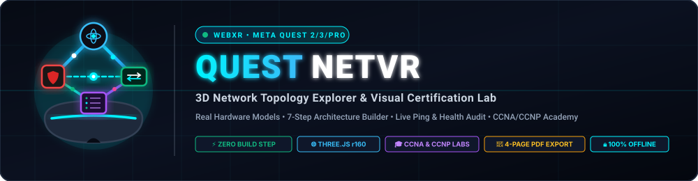
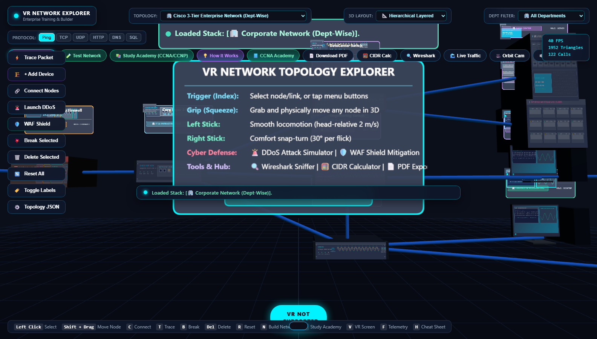
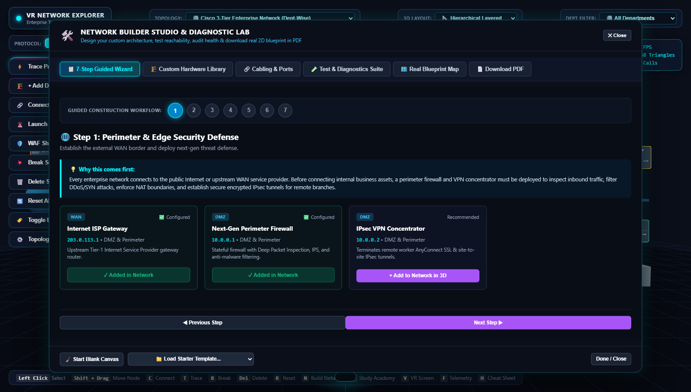
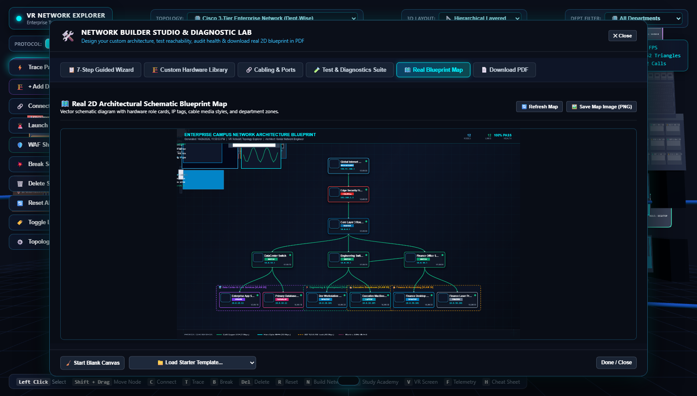
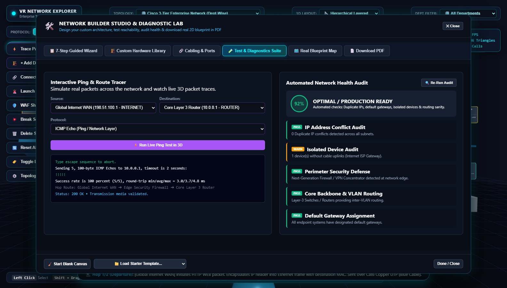
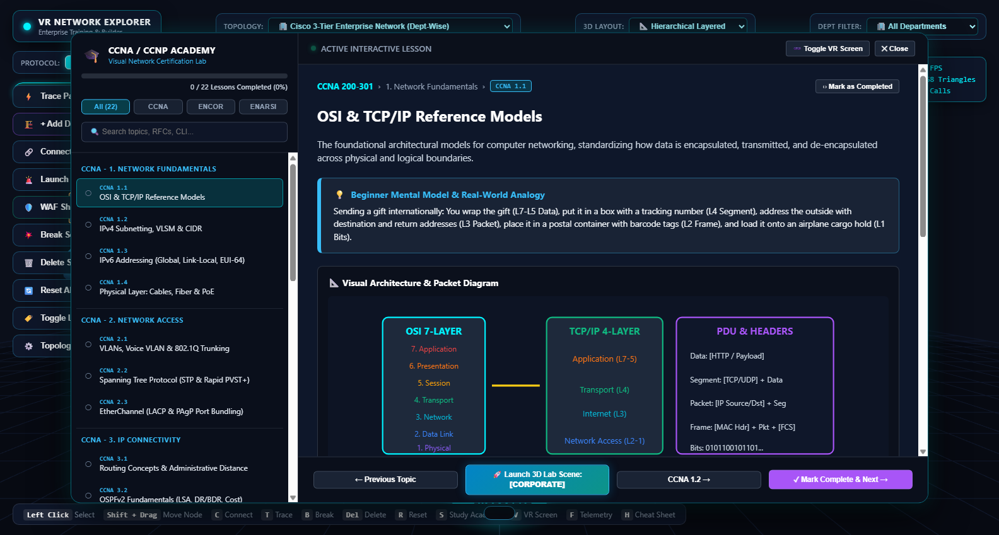
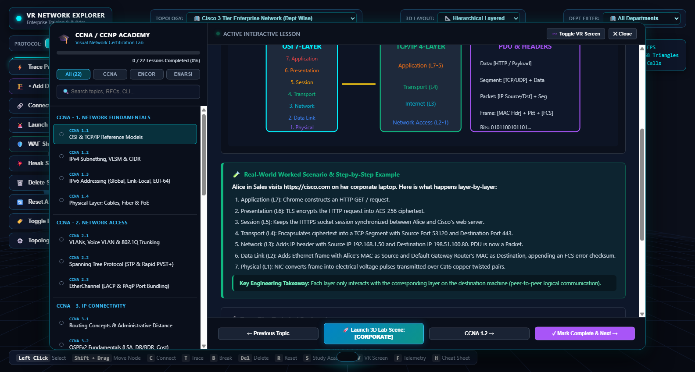
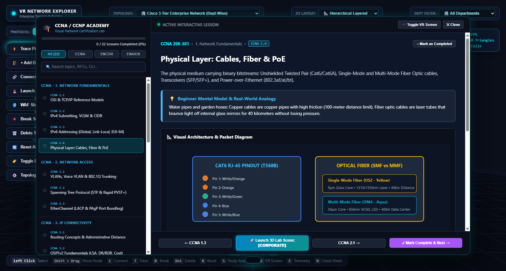
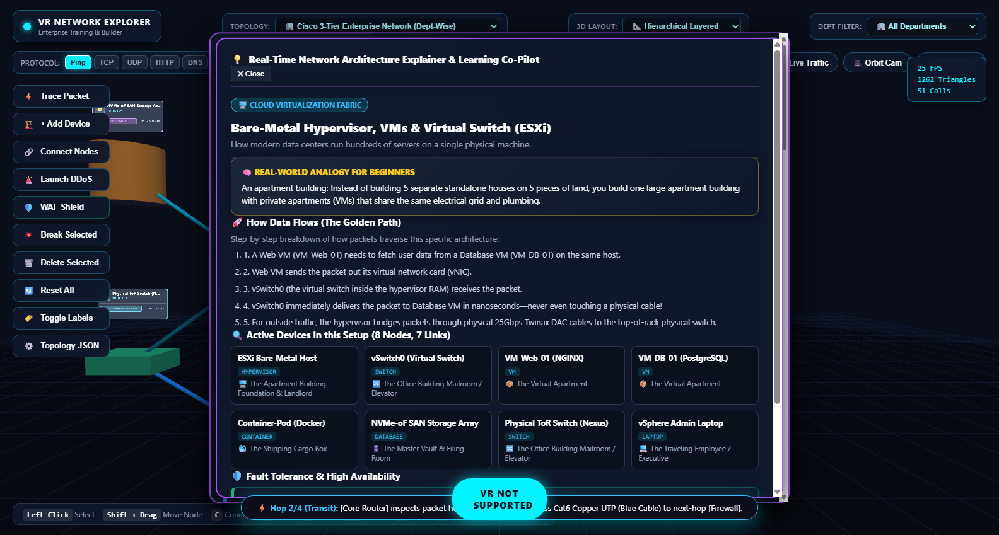

<p align="center">
  
</p>

# 🌐 Quest NetVR - 3D Network Topology Explorer & Certification Academy

<p align="center">
  
  
  
  
  
</p>

An interactive, zero-build **WebXR Network Engineering Suite, Visual Certification Academy, and Architecture Builder** built specifically for the **Meta Quest 2 / Quest 3 / Pro Browser** and modern desktop browsers (Chrome, Edge, Firefox, Safari).

Walk inside enterprise corporate networks in 3D/VR, trace multi-protocol packet flows hop-by-hop, design your own custom architecture with **real 3D hardware equipment models**, test reachability with an integrated Cisco CLI ping suite, inspect live packet headers in Wireshark-lite, master CCNA/CCNP certification curriculums with worked real-world examples, and export publication-grade **2D Architectural Blueprint Maps & 4-Page PDF Reports**.

---

<p align="center">
  
  <br>
  <em>Interactive 3D WebXR Campus Network with Photorealistic Cisco Switches, Routers, Servers, and In-World Equipment HUDs</em>
</p>

---

## 📑 Table of Contents

- [Why This Exists](#-why-this-exists)
- [Target Audience](#-who-its-for)
- [Core Features Overview](#-core-features-overview)
  - [1. Real 3D Hardware Equipment Models & Faceplates](#1-real-3d-hardware-equipment-models--faceplates)
  - [2. Build Your Own Network Studio (7-Step Guided Workflow)](#2-build-your-own-network-studio-7-step-guided-workflow)
  - [3. Real 2D Architectural Schematic Blueprint Map](#3-real-2d-architectural-schematic-blueprint-map)
  - [4. Interactive Testing, Ping & 5-Point Health Diagnostics Suite](#4-interactive-testing-ping--5-point-health-diagnostics-suite)
  - [5. Professional 4-Page PDF Blueprint & BOM Exporter](#5-professional-4-page-pdf-blueprint--bom-exporter)
  - [6. Topic-Wise Study Academy (CCNA, CCNP ENCOR, CCNP ENARSI)](#6-topic-wise-study-academy-ccna-ccnp-encor-ccnp-enarsi)
  - [7. 3D WebXR Classroom Billboard (In-Headset VR Learning)](#7-3d-webxr-classroom-billboard-in-headset-vr-learning)
  - [8. Physical Cabling & Connector Visuals (RJ-45 & LC Fiber)](#8-physical-cabling--connector-visuals-rj-45--lc-fiber)
  - [9. Comprehensive Network Topologies Library (23 Presets)](#9-comprehensive-network-topologies-library-23-presets)
  - [10. Cyber Security Attack & Mitigation Suite (DDoS / WAF)](#10-cyber-security-attack--mitigation-suite-ddos--waf)
  - [11. Wireshark-Lite Live Packet Sniffer](#11-wireshark-lite-live-packet-sniffer)
  - [12. Interactive IPv4 CIDR Subnet Calculator](#12-interactive-ipv4-cidr-subnet-calculator)
  - [13. Multi-Protocol Traffic Engine & Ambient NOC Audio](#13-multi-protocol-traffic-engine--ambient-noc-audio)
- [Controls Cheatsheet](#-controls-cheatsheet)
  - [Desktop Mouse & Keyboard](#desktop-mouse--keyboard)
  - [Meta Quest Touch Controllers](#meta-quest-touch-controllers)
- [Getting Started (Run Locally in 5 Seconds)](#-getting-started-run-locally-in-5-seconds)
- [Deploying to Netlify Drop](#-deploying-to-netlify-drop)
- [License](#-license)

---

## 💡 Why This Exists

Traditional networking education relies on dry 2D topology diagrams, black-and-white CLI text consoles, and abstract packet capture hex dumps. Beginners and certification students struggle to visualize:
- How physical cables (Cat6 copper vs OS2/OM4 fiber) connect to physical switch ports.
- Why packets take specific multi-hop paths through VLANs, Spanning Tree root bridges, and NAT overload firewalls.
- What happens when a link breaks or a DDoS SYN flood strikes the perimeter.

**VR Network Topology Explorer** transforms invisible radio waves, light pulses, and binary packets into **tangible, interactive 3D spatial environments**. You can walk through the network, rewire cables, simulate ping packets, and learn networking visually from start to finish.

---

## 🎯 Who It's For

- **CCNA & CCNP Certification Students**: Visual study guides, Cisco CLI snippets with 1-click copy, exam traps, and 1-click 3D lab topologies.
- **Network Engineers & Architects**: Prototype multi-tier enterprise networks, test subnet sanity, and export Visio-grade 2D architectural blueprint maps and 4-page PDF documentation.
- **IT Educators & University Professors**: Interactive classroom presentation tool with floating VR billboards and live packet simulations.
- **Junior Sysadmins & Support Engineers**: Intuitive mental models and analogies explaining OSI layers, default gateways, and DNS/DHCP workflows.

---

## 🚀 Core Features Overview

### 1. Real 3D Hardware Equipment Models & Faceplates

Every node in the virtual environment is modeled with physical fidelity and high-definition front-panel faceplates:

- **🔀 Cisco Catalyst 9300 Switch**: 1U rack-mount chassis with rack ears, **24 staggered RJ-45 Gigabit ports** with metallic shielding, gold pin contacts, green link LEDs, **4× 10G SFP+ uplink cages**, RJ-45 console port, and status LEDs (`SYST`, `STAT`, `PoE`).
- **🔄 Cisco ISR 4331 Modular WAN Router**: 2U chassis with dual routed GE interfaces (`GE 0/0/0`, `GE 0/0/1`), SFP combo port, light-blue serial console/aux ports, and **dual modular NIM expansion slots** with knurled thumbscrews.
- **🖥️ Enterprise 2U Rack Server (Dell PowerEdge / Cisco UCS)**: Brushed titanium bezel, **8 hot-swap 2.5" SAS/NVMe drive bays** with release latches and blinking activity LEDs, glowing blue power/UID button, diagnostic LCD, and honeycomb ventilation grilles.
- **🛡️ Next-Gen Threat Defense Firewall**: Safety-red security bezel with color-coded dedicated security zone ports (Red WAN, Yellow DMZ, Green Internal LAN, Blue HA Sync) and security shield badge.
- **🗄️ Enterprise SAN Storage Array / Database**: 3U chassis with **12 hot-swap enterprise drive trays** in a 3×4 grid with green/amber disk I/O activity LEDs and RAID-6 controller display.
- **💻 Desktop Workstation**: Thin-bezel LCD monitor displaying an **active CLI terminal running `ping 10.0.1.1`** and a live cyan network throughput graph, with an aluminum stand and desktop tower.
- **💻 Mobile Staff Laptop**: Anodized aluminum unibody clamshell with keyboard deck, trackpad, and screen displaying a network dashboard.
- **🖨️ Office Network Laser Printer**: White/slate body with color touchscreen LCD showing `● READY TO PRINT`, IP address, toner status, paper output tray, and dual paper drawers.
- **📶 Wi-Fi 6 Access Point (Catalyst 9120AX)**: Ceiling-mount AP with central Cisco logo and glowing green/cyan multi-color LED ring.
- **📞 Cisco VoIP Desk Phone (8845)**: IP Phone with tilted color display showing extension `EXT: 4010 [ENGINEERING]`, SIP registration status, numeric dial pad, and coiled handset.
- **🏷️ In-World Floating HUD Cards**: Hovering billboard cards above each device displaying the **photorealistic equipment photo**, device full name, IPv4 address, and department badge.

---

### 2. Build Your Own Network Studio (7-Step Guided Workflow)

Click **`🛠️ Build Network`** in the header or press `N` on your keyboard to open the **Network Builder Studio**:

<p align="center">
  
  <br>
  <em>7-Step Guided Network Construction Studio with Engineering Rationale & 1-Click Hardware Deployment</em>
</p>

1. **🌐 Step 1: Perimeter & Edge Defense**: Upstream Tier-1 ISP Gateway (`203.0.113.1`), Next-Gen Firewall (`10.0.0.1`), and IPsec VPN Concentrator (`10.0.0.2`).
2. **🔄 Step 2: Core & Distribution Switching**: Core Layer-3 Switch (`10.0.1.1`) and Distribution Router (`10.0.1.254`).
3. **🏢 Step 3: Department Servers & Data Center**: Corporate Web Server (`10.0.10.10`), PostgreSQL Database Cluster (`10.0.10.20`), VMware ESXi Hypervisor (`10.0.10.30`), and DNS/DHCP Server (`10.0.1.5`).
4. **💻 Step 4: End-User Workstations & Peripherals**: Engineering PCs, Finance Workstations, Executive Laptops, Network Laser Printers, Wi-Fi 6 APs, and VoIP Desk Phones.
5. **🔗 Step 5: Physical Cabling & Ports**: Connect nodes with Cat6 Copper (1G), LC Optical Fiber (10G), 802.1Q Trunks (40G), or Wireless 5GHz. Includes a **✨ Auto-Wire Tool** to connect all unlinked devices in 1 click!
6. **🧪 Step 6: Test Everything & Run Diagnostics**: Live interactive ping testing, traceroute hops, and automated IP sanity checks.
7. **🗺️ Step 7: Real Architectural Map & PDF Blueprint**: Inspect the live 2D architectural blueprint map and export the complete 4-page PDF engineering report.

*Users can also start from a **🧹 Blank Canvas** to build from scratch or load curated **Starter Templates** (Small Business Office or Enterprise Campus).*

---

### 3. Real 2D Architectural Schematic Blueprint Map

Switch to the **`🗺️ Real Blueprint Map`** tab to view your network rendered as a publication-grade 2D architectural schematic:

<p align="center">
  
  <br>
  <em>Real 2D Architectural Schematic Map with Equipment Photos, IP Badges, Cable Indicators, and Department Zones</em>
</p>

- **Hierarchical Tier Zoning**: Automatically organizes nodes into clean logical tiers (WAN/Internet $\rightarrow$ Firewalls $\rightarrow$ Core L3 $\rightarrow$ Access Switches $\rightarrow$ Endpoints/Servers).
- **Department Cluster Containers**: Translucent bounding boxes group devices by department with glowing colored borders and VLAN subnet tags.
- **Hardware Device Cards**: High-contrast cards displaying custom hardware vector thumbnails, device name, hardware role chip, monospace IP address badge, and real-time status LED.
- **Physical Cabling Indicators**: Curved Bezier lines color-coded by transmission media (Cat6 Green, Fiber Cyan/Blue, 802.1Q Trunk Amber, Wireless Magenta).
- **One-Click Image Download**: Save the architectural blueprint directly as a high-resolution PNG image (`enterprise-network-blueprint.png`).

---

### 4. Interactive Testing, Ping & 5-Point Health Diagnostics Suite

Click **`🧪 Test Network`** in the header or open the Testing tab inside the Studio:

<p align="center">
  
  <br>
  <em>Live Cisco IOS Ping Terminal, Multi-Protocol Traceroute & Automated 5-Point Health Sanity Audit</em>
</p>

- **⚡ Interactive Ping & Route Tracer**:
  - Select any Source and Destination device from the network.
  - Choose protocol: `ICMP Echo (Ping)`, `HTTP/S (80/443)`, `DNS (53)`, or `VoIP (5060)`.
  - Triggers live **3D glowing packet animations** across the physical links in the Three.js viewport with realistic sound effects.
  - Displays real Cisco IOS terminal ping logs:
    ```text
    Type escape sequence to abort.
    Sending 5, 100-byte ICMP Echos to 10.0.10.10, timeout is 2 seconds:
    !!!!!
    Success rate is 100 percent (5/5), round-trip min/avg/max = 1.8/2.4/3.2 ms
    Hop Route: Finance Workstation ➔ Core L3 Switch ➔ Enterprise Web Server
    Status: 200 OK • Transmission media validated.
    ```
- **🔍 Automated 5-Point Network Health Audit**:
  - Automatically audits:
    1. **Duplicate IP Conflicts**: Flags duplicate IP addresses across subnets.
    2. **Isolated Devices**: Flags devices without active physical or wireless cables.
    3. **Perimeter Security Check**: Verifies that a firewall or VPN concentrator guards the edge.
    4. **Core Switching Check**: Confirms routing backbone devices exist.
    5. **Default Gateway Check**: Verifies that endpoint workstations have assigned default gateways.
  - Computes an overall **Health Score (0-100%)** with an engineering grade (e.g. `100% - OPTIMAL / PRODUCTION READY`).

---

### 5. Professional 4-Page PDF Blueprint & BOM Exporter

Click **`📄 Download PDF`** to export a publication-grade landscape A4 PDF document:

- **Page 1: 🗺️ The Real Architectural Schematic Map**: Full-page high-resolution 2D blueprint diagram showing all hardware nodes, IP tags, cable media, and department zones with executive metrics.
- **Page 2: 🧪 Verification, Testing & Health Diagnostic Audit**: Automated Health Audit Checklist with Pass/Warn/Fail badges, Live Ping & Packet Tracer Execution Log table, and 3D WebGL Perspective Render Snapshot.
- **Page 3: 📋 Bill of Materials (BOM) & Device Inventory Matrix**: Complete tabular inventory: Device Full Name, Hardware Role, Department, IPv4 / Subnet Mask, MAC Address, Default Gateway, VLAN ID, Status, Connected Peers.
- **Page 4: 🔗 Physical Cabling & Interconnection Port Schedule**: Complete cabling matrix: Link ID, Source Device & Port, Destination Device & Port, Physical Media Type (Cat6 / SFP+ Fiber / Trunk), Link Bandwidth Speed, Status.

---

### 6. Topic-Wise Study Academy (CCNA, CCNP ENCOR, CCNP ENARSI)

Click **`📚 Study Academy (CCNA/CCNP)`** or press `S` on your keyboard to open the curriculum:

<p align="center">
  
  <br>
  <em>Topic-Wise Certification Curriculum with Real Hardware Photos, Worked Examples & 1-Click 3D Labs</em>
</p>

#### Exhaustive Syllabus Coverage (22 Lessons)
1. **CCNA (200-301) Track**:
   - **Network Fundamentals**: OSI 7-Layer vs TCP/IP 4-Layer, IPv4 Subnetting & VLSM, IPv6 Global/Link-Local/EUI-64, Physical Layer Cables & PoE.
   - **Network Access**: 802.1Q VLANs & Voice VLAN, Spanning Tree (STP/RSTP/PVST+), EtherChannel LACP & PAgP.
   - **IP Connectivity**: Routing Concepts & AD, OSPFv2 Multi-Area Link-State, FHRP (HSRP & VRRP Gateway Redundancy).
   - **IP Services**: NAT/PAT Overload, DHCP DORA & Recursive DNS, Quality of Service (QoS) & Policing.
   - **Security Fundamentals**: Standard & Extended ACLs, Layer 2 Security (Port Security, DHCP Snooping, Dynamic ARP Inspection).
   - **Automation & Programmability**: SDN Architecture, REST APIs, JSON data, and Cisco DNA Center.
2. **CCNP ENCOR (350-401) Track**:
   - **Cisco SD-WAN & VXLAN Overlay Fabric**: Decoupling overlays from underlays; VXLAN UDP port 4789 and 24-bit VNI.
   - **BGP Path Attributes & Route Selection**: Multi-attribute route selection (Weight, Local Pref, AS-Path, MED, eBGP vs iBGP).
   - **Enterprise Wireless (Catalyst 9800 & CAPWAP)**: Split-MAC architecture, CAPWAP Control (UDP 5246) and Data (UDP 5247), Wi-Fi 6 roaming.
3. **CCNP ENARSI (300-410) Track**:
   - **Advanced OSPFv2/v3**: Not-So-Stubby Areas (NSSA), Type-7 to Type-5 translation, OSPF Virtual Links.
   - **MPLS LDP & Layer 3 BGP VPNs**: 32-bit shim labels, Penultimate Hop Popping (PHP), Provider Edge (PE) and Core (P) LSR routers.
   - **Dynamic Multipoint VPN (DMVPN Phase 3)**: Multipoint GRE (mGRE), NHRP Redirect & Shortcut, dynamic spoke-to-spoke IPsec tunnels.

<p align="center">
  
  <br>
  <em>Concrete Real-World Worked Scenarios with Step-by-Step Walkthroughs & Practical Engineering Rules-of-Thumb</em>
</p>

#### Every Lesson Includes:
- 💡 **Everyday Mental Model & Analogy**: Plain-English analogies (e.g. shipping containers, airport baggage barcodes, flight co-pilots) that clarify complex protocol internals for complete beginners.
- 📸 **Real-World Hardware Showcase**: High-resolution equipment photo with engineering specs, port layouts, and deployment roles.
- 🧪 **Concrete Worked Scenarios**: Step-by-step real-world walkthroughs (e.g., *Alice in Sales browsing cisco.com*, *Carving 192.168.10.0/24 for three departments*, *Deriving link-local IPv6 from a MAC address*, *Simulating router power failure with HSRP VIP*).
- 📐 **Interactive SVG Architectural Diagrams**: Crisp vector graphics illustrating encapsulation headers, frame formats, and traffic flows.
- 🔬 **Deep-Dive Technical Theory**: RFC references, finite-state machine transitions, packet structures, and calculation formulas.
- 🖥️ **Production Cisco IOS CLI Commands**: Syntax-highlighted CLI terminal blocks with a 1-click **📋 Copy CLI Commands** button to copy configurations into Packet Tracer, GNS3, EVE-NG, or physical Cisco hardware.
- 🎯 **Exam Traps & Certification Tips**: Critical warnings on common multiple-choice exam traps (e.g. OSPF timer mismatches, STP priority increments of 4096, HSRP preemption).
- 🚀 **1-Click 3D Lab Scene Launch**: Instantly loads the exact corresponding 3D topology into the WebXR viewport and positions nodes for real-time packet tracing.

---

### 7. 3D WebXR Classroom Billboard (In-Headset VR Learning)

Study while remaining inside Virtual Reality! When using a **Meta Quest 2 / Quest 3 / Pro** headset:
- Press the **`🕶️ Toggle VR Screen`** button or press `V` on your keyboard (or trigger the in-VR button).
- A floating high-resolution 3D billboard (`CanvasTexture` at 1200×725 resolution) appears in 3D space directly in front of you.
- Use your Oculus Touch controller raycaster laser to click:
  - `[◄ Prev Topic]` / `[Next Topic ►]` to step through lessons.
  - `[🚀 Spawn 3D Lab]` to materialize the lesson's physical network in the virtual room!
  - `[✕ Hide Screen]` to dock the display.

---

### 8. Physical Cabling & Connector Visuals (RJ-45 & LC Fiber)

Click **`📘 CCNA Academy`** to inspect physical layer transmission media and pinout standards:

<p align="center">
  
  <br>
  <em>Detailed Visual Pinouts for RJ-45 (T568A/T568B) and LC Duplex Optical Fiber Transceivers</em>
</p>

- **RJ-45 (8P8C) Modular Plug Illustration**: Complete color-coded pinout (T568B: White/Orange, Orange, White/Green, Blue, White/Blue, Green, White/Brown, Brown) with gold-plated contact points.
- **Optical Fiber Transceiver (LC Duplex)**:
  - **Single-Mode Fiber (OS2 Yellow)**: 9µm core, 1310/1550nm Laser, 40km range.
  - **Multi-Mode Fiber (OM4 Aqua)**: 50µm core, 850nm VCSEL LED, 400m data center range.
  - Illustrates physical TX (Transmit) and RX (Receive) ceramic ferrules.

---

### 9. Comprehensive Network Topologies Library (23 Presets)

<p align="center">
  
  <br>
  <em>23 Built-in Topologies Ranging from Basic LANs to Enterprise Clos Fabrics, DMVPN & MPLS</em>
</p>

1. **Star Topology**: Central access switch interconnecting department workstations, laptops, and printers.
2. **Ring Topology**: Redundant closed ring with automated failover testing.
3. **Full Mesh Topology**: Complete $N(N-1)/2$ interconnection matrix with zero single points of failure.
4. **Bus Topology**: Classic linear trunk cable with BNC T-connectors and 50-ohm terminators.
5. **Spine-and-Leaf Clos Fabric**: High-bandwidth data center fabric with 100G uplinks.
6. **Campus LAN & Wi-Fi 6**: Multi-building access layer with PoE+ switches, WAPs, and IP phones.
7. **Industrial IoT / SCADA**: Purdue Enterprise Reference Architecture (PERA) with PLC sensors.
8. **Cisco 3-Tier Enterprise**: Core, Distribution, and Access layers with redundant uplinks.
9. **3-Tier Cloud Web Architecture**: Internet WAN, Cloud VPC, WAF, Load Balancers, Web tier, and DB cluster.
10. **SD-WAN Multi-Site Branch VPN**: Hub-and-spoke encrypted overlays across dual ISP transports.
11. **STP & EtherChannel Lab**: Loop resolution with root bridge election and LACP bundles.
12. **FHRP Gateway Redundancy**: HSRP/VRRP active/standby router failover with Virtual IPs.
13. **NAT / PAT Address Translation**: Inside local to inside global port multiplexing.
14. **DHCP & DNS Services**: DORA handshake simulation and recursive DNS resolution.
15. **BGP & MPLS WAN Core**: Autonomous system peering and MPLS label-switched paths.
16. **Enterprise Wireless WLC**: Split-MAC architecture with CAPWAP tunnels.
17. **DMVPN Phase 3**: Multipoint GRE tunnels with dynamic spoke-to-spoke resolution.
18. **VXLAN & EVPN Fabric**: BGP EVPN control plane and VXLAN encapsulation.
19. **OSPF Multi-Area**: Backbone Area 0 and standard/stub areas with ABR/ASBR routers.
20. **IPsec Site-to-Site VPN**: Cryptographic ESP tunnels with AES-256 encryption.
21. **Zero-Trust Network Access**: Micro-segmented container pods with strict security boundaries.
22. **Small Business Office**: Compact starter network with firewall, switch, and office devices.
23. **Blank Canvas**: Clean workspace ready for step-by-step construction.

---

### 10. Cyber Security Attack & Mitigation Suite (DDoS / WAF)

- Click **`🚨 Launch DDoS`** to simulate a massive distributed TCP SYN flood originating from botnet nodes across the Internet.
- Watch thousands of high-velocity red attack pulses barrage the perimeter firewall, causing connection queues to spike and link latency to flash red.
- Click **`🛡️ WAF Shield`** to deploy Next-Gen Web Application Firewall mitigation: malicious attack packets are immediately dropped at the perimeter, restoring normal green traffic flow to internal servers!

---

### 11. Wireshark-Lite Live Packet Sniffer

Click **`🔍 Wireshark`** in the header to open the promiscuous mode packet sniffer drawer:
- Captures live network traffic in real time.
- Displays standard Wireshark columns: Frame No., Timestamp, Source IP, Destination IP, Protocol, Length, and Packet Info summary.
- Inspect TCP SYN/ACK flags, DNS query resolution strings, HTTP GET headers, and ICMP echo payloads.
- Filter or clear capture with a single click.

---

### 12. Interactive IPv4 CIDR Subnet Calculator

Click **`🧮 CIDR Calc`** in the header or press `Enter` in the calculator modal:
- Enter any IPv4 address with prefix (e.g. `192.168.10.0/24`, `10.0.0.0/16`, `172.16.50.0/27`).
- Instantly computes:
  - Network ID & Broadcast Address
  - Subnet Mask & Wildcard Mask
  - Usable Host Range (`First Usable` $\leftrightarrow$ `Last Usable`)
  - Total Usable IPv4 Host Count
  - Binary Subnet Mask representation (showing network vs host bit boundaries)

---

### 13. Multi-Protocol Traffic Engine & Ambient NOC Audio

- **Protocol Packet Generator**: Select between `HTTP`, `DNS`, `SQL`, `ICMP`, and `VoIP` in the top bar to fire colored protocol packets across links.
- **Wave Particle Animation**: Packets travel along curved 3D link paths with glowing tails and pulse effects.
- **Synthesized Web Audio Engine**: Integrated audio generator produces subtle click, hum, ping, and warning sound effects without any external MP3 files! Toggle with the **`🔊 Sound`** button.
- **Ambient NOC Mode**: Click **`🌊 Live Traffic`** to generate continuous background traffic simulating a live Network Operations Center.
- **360° Cinematic Orbit**: Click **`🎥 Orbit Cam`** for smooth presentation camera rotation around your architecture.

---

## 🎮 Controls Cheatsheet

### Desktop Mouse & Keyboard

| Control | Action |
| :--- | :--- |
| **Left Click** | Select device or cable to inspect properties |
| **Left Click + Drag** | Orbit camera around the 3D scene |
| **Right Click + Drag** | Pan camera laterally |
| **Mouse Wheel** | Zoom in / Zoom out |
| **Shift + Click & Drag** | Move selected device to a new 3D position |
| **`N`** | Open **Network Builder Studio & Diagnostics** |
| **`S`** | Open **Topic-Wise Study Academy** |
| **`V`** | Toggle **In-Headset 3D VR Classroom Billboard** |
| **`C`** | Toggle **Connect Nodes** tool (Click Node A $\rightarrow$ Click Node B) |
| **`T`** | Toggle **Trace Packet** tool |
| **`B`** | Break / repair selected link or device |
| **`Del` / `Backspace`** | Delete selected device or cable from network |
| **`R`** | Reset network topology to default state |
| **`F`** | Toggle real-time FPS, triangle count, and draw call telemetry |
| **`H`** | Toggle on-screen controls cheatsheet overlay |

### Meta Quest Touch Controllers

| Button / Trigger | Controller | Action |
| :--- | :--- | :--- |
| **Trigger** | Right / Left | Select device, click buttons, or grab nodes |
| **Grip Button** | Right / Left | Hold to drag and reposition devices in 3D space |
| **Thumbstick (Click)** | Right / Left | Teleport to target location on the floor |
| **Thumbstick (Tilt)** | Right / Left | Smooth locomotion & snap rotation |
| **`A` / `X` Button** | Right / Left | Toggle In-VR Floating Controls Menu |
| **`B` / `Y` Button** | Right / Left | Quick Packet Trace from pointed device |

---

## 🛠️ Getting Started (Run Locally in 5 Seconds)

Because this is a **pure static front-end application** built with standard ES modules and Three.js r160, there is **NO npm, NO bundler, and NO build step** required!

### Option 1: Python HTTP Server (Built into Windows/macOS/Linux)
Open a terminal in the project directory and run:
```bash
python -m http.server 8000
```
Open your browser and navigate to:
```
http://localhost:8000/
```

### Option 2: Node.js `npx serve`
```bash
npx serve .
```

### Option 3: VS Code Live Server
Right-click `index.html` in VS Code and click **Open with Live Server**.

---

## 🌐 Deploying to Netlify Drop

1. Go to [app.netlify.com/drop](https://app.netlify.com/drop).
2. Drag and drop the entire project folder into your browser window.
3. Your 3D WebXR simulator is instantly live with a public HTTPS URL ready for your Meta Quest headset!

---

## 📄 License

This project is licensed strictly for **personal, educational, and academic non-commercial use only**. Commercial use, resale, sublicensing, or commercial redistribution of this software or its visual assets is strictly prohibited.
